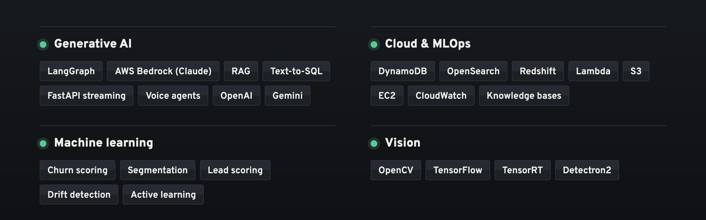

<!--
Matches the portfolio at abubakarjutt.github.io: a night departure board.
Graphite board, split-flap tiles, one signal green for live states.
The banner and stack panel are PNGs rendered from HTML so GitHub shows the
real Overpass type; everything else is plain Markdown.
-->

Most GenAI pilots look great in the demo and break on real data. I work on the part that comes after: getting them into production and keeping them working.

As a forward deployed engineer for Addo AI, I built a plain-English data and HR assistant for the 3,000+ employees of Engro Holdings (LangGraph, AWS Bedrock, FastAPI with streaming). BI queries dropped **68%**, HR queries dropped **89%**, and the client's own engineers now maintain it. At RAKEZ in the UAE, I shipped churn, segmentation and lead-scoring models that run in production with drift detection and automated retraining.

**[Portfolio](https://abubakarjutt.github.io/)** &nbsp;·&nbsp; **[Book a call](https://calendly.com/abubakarjutt/new-meeting)** &nbsp;·&nbsp; **[LinkedIn](https://www.linkedin.com/in/muhammad-abubakar-ds/)**

## Departures

| When | Service | Operator | Status | Result |
| :-- | :-- | :-- | :-- | :-- |
| Aug 2026 – now | Senior Data Scientist (AI/ML) | Addo AI | 🟢 In service | Conversational AI platform on LangGraph, Bedrock and FastAPI. **−68%** BI queries, **−89%** HR queries; trained 4 engineers to maintain it |
| Oct 2025 – now | Forward Deployed Engineer, for Addo AI | RAKEZ, UAE | 🟢 In service | Churn, renewal and lead-priority models in production, with drift detection and retraining |
| Aug 2024 – Sep 2025 | Forward Deployed Engineer, for Addo AI | Engro Holdings | Arrived | Plain-English data and HR assistant for 3,000+ employees. **−68%** BI queries, **−89%** HR queries; trained 2 junior engineers and 2 peers |
| Jul 2024 – Aug 2026 | Data Scientist (AI/ML) | Addo AI | Arrived | Engro conversational AI platform; video anomaly detection with **−35%** annotation effort and **+42%** throughput |
| Mar 2022 – Jun 2024 | Associate Data Scientist (AI/ML) | Addo AI | Arrived | Annotation tooling with T5, Detectron2, spaCy and active learning: **82–96%** less annotation time; mentored 3 junior scientists |
| Feb 2021 – Feb 2022 | Research Associate | ITU | Arrived | Crime-pattern EDA and bias mitigation; published findings |
| Jul 2019 – Jan 2020 | Machine Learning Intern | Auxtend | Arrived | Fine-tuned a transformer chatbot and rebuilt semantic search: **+20%** accuracy, **+30%** relevance |

## Stack

## Featured builds

**[graphbrain](https://github.com/Abubakarjutt/graphbrain)**: turns any input into a persistent, queryable knowledge graph.

**[Trivio](https://github.com/Abubakarjutt/Trivio)**: building in the open.

## Education

| Degree | Institution | Years |
| :-- | :-- | :-- |
| M.S. Data Science | University of Management and Technology | 2018–2020 |
| B.S. Accounting and Finance | University of Central Punjab | 2013–2016 |

## Contact

Email **abubakarsahi@hotmail.com**, [book a call](https://calendly.com/abubakarjutt/new-meeting), or [connect on LinkedIn](https://www.linkedin.com/in/muhammad-abubakar-ds/). I speak English and Urdu.
