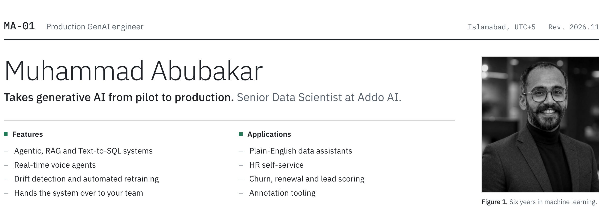
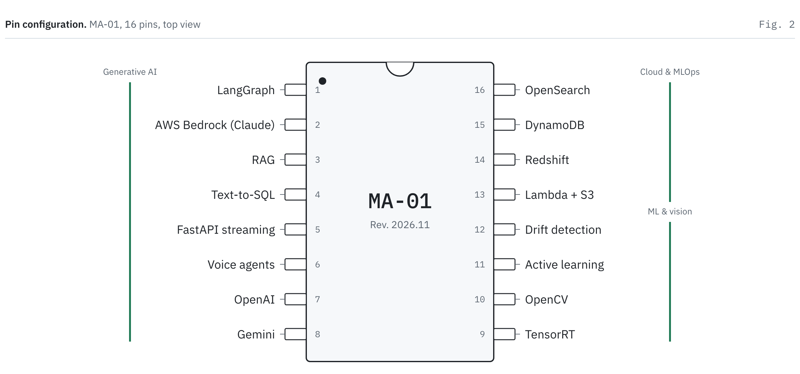

<!--
Datasheet for part MA-01. A sibling of abubakarjutt.github.io, not a copy:
the site is a night departure board; this profile is a component datasheet.
IBM Plex on GitHub's own ground, hairline rules, one green mark.
Images are rendered from HTML in light and dark to sit flush on either theme.
-->

<picture>
  <source media="(prefers-color-scheme: dark)" srcset="assets/header-dark.png">
  
</picture>

### General description

Most GenAI pilots look great in the demo and break on real data. I work on the part that comes after: getting them into production and keeping them working.

As a forward deployed engineer for Addo AI, I built a plain-English data and HR assistant for the 3,000+ employees of Engro Holdings, on LangGraph, AWS Bedrock and FastAPI with streaming. The client's own engineers now maintain it. At RAKEZ in the UAE, I shipped churn, segmentation and lead-scoring models that run in production with drift detection and automated retraining.

### Typical performance

| Parameter | Conditions | Value |
| :-- | :-- | --: |
| BI request volume | Engro Holdings, 3,000+ employees | **−68%** |
| HR request volume | Engro Holdings, 3,000+ employees | **−89%** |
| Annotation time | T5, Detectron2, spaCy with active learning | **−82% to −96%** |
| Video annotation effort | Anomaly detection pipeline | **−35%** |
| Video throughput | Anomaly detection pipeline | **+42%** |
| Chatbot accuracy | Fine-tuned transformer, Auxtend | **+20%** |
| Search relevance | Semantic search rebuild, Auxtend | **+30%** |

### Pin configuration

<picture>
  <source media="(prefers-color-scheme: dark)" srcset="assets/pins-dark.png">
  
</picture>

### Revision history

| Rev. | Date | Description of change |
| :-- | :-- | :-- |
| 7 | Aug 2026 – present | **Senior Data Scientist (AI/ML), Addo AI.** Conversational AI platform; trained 4 engineers to maintain it |
| 6 | Oct 2025 – present | **Forward Deployed Engineer, RAKEZ, UAE** (for Addo AI). Churn, renewal and lead-priority models with drift detection and retraining |
| 5 | Aug 2024 – Sep 2025 | **Forward Deployed Engineer, Engro Holdings** (for Addo AI). Plain-English data and HR assistant; trained 2 junior engineers and 2 peers |
| 4 | Jul 2024 – Aug 2026 | **Data Scientist (AI/ML), Addo AI.** Engro platform; video anomaly detection |
| 3 | Mar 2022 – Jun 2024 | **Associate Data Scientist (AI/ML), Addo AI.** Annotation tooling; mentored 3 junior scientists |
| 2 | Feb 2021 – Feb 2022 | **Research Associate, ITU.** Crime-pattern EDA and bias mitigation; published findings |
| 1 | Jul 2019 – Jan 2020 | **Machine Learning Intern, Auxtend.** Transformer chatbot and semantic search |
| 0 | 2013 – 2020 | **Initial release.** B.S. Accounting and Finance, University of Central Punjab (2013–2016); M.S. Data Science, University of Management and Technology (2018–2020) |

### Reference designs

- **[graphbrain](https://github.com/Abubakarjutt/graphbrain)**: turns any input into a persistent, queryable knowledge graph.
- **[Trivio](https://github.com/Abubakarjutt/Trivio)**: in development, built in the open.

### Ordering information

| Channel | Address |
| :-- | :-- |
| Book a call | [calendly.com/abubakarjutt/new-meeting](https://calendly.com/abubakarjutt/new-meeting) |
| Email | abubakarsahi@hotmail.com |
| Portfolio | [abubakarjutt.github.io](https://abubakarjutt.github.io/) |
| LinkedIn | [in/muhammad-abubakar-ds](https://www.linkedin.com/in/muhammad-abubakar-ds/) |

Languages supported: English, Urdu. Every figure on this sheet comes from a system in production.
