<!--
THESIS: prove production competence through format, not adjectives — the
profile reads like a system he'd actually run, not a portfolio page about one.
OWN-WORLD: near-black ground, phosphor-green monospace, terminal chrome,
scanline/CRT bloom, 80-column discipline, status-readout register.
STORY: a recruiter reads whoami → status → deploy log → stack → contact,
each line load-bearing, no line decorative.
FIRST VIEWPORT: terminal-window banner running `whoami`, name at display
scale, one-line thesis beneath, tech line, idle prompt with blinking cursor.
FORM: concept-seed direction 5 (CLI/terminal session), fused with dealt
challenger phosphor-terminal-midnight (scanline glow, cursor bloom, P1
green). seed key 9f37b2b5.
FINISH: unreviewed and undocumented is unfinished; this build ends with the
finish review, the verdict, and DESIGN.md.
-->

<div align="center">

<picture>
  <source media="(prefers-color-scheme: dark)" srcset="assets/banner-dark.svg">
  <source media="(prefers-color-scheme: light)" srcset="assets/banner-light.svg">
  
</picture>

</div>

<br>

```text
$ status --check
[ok] production systems, 6+ yrs live
[ok] now: Sr. Full Stack DS @ Addo
[ok] fwd-deployed — RAKEZ, UAE
[ok] open to: full-time, remote
[ok] relocate: EU / UK / Gulf
```

I build AI systems that stay in production after I leave. Over six-plus years I've designed, shipped, and operated ML and GenAI systems for enterprise clients across the US and the Gulf — most recently a LangGraph + AWS Bedrock conversational platform that lets 3,000+ employees at Engro Holdings query internal databases and self-serve HR information in plain English. I work directly with sales, CX, and ops stakeholders to turn ambiguous business questions into deployed systems, then train the client's own engineers to run them without me.

## deploy log

```text
RAKEZ, UAE · Oct 2025 → now
  Senior Data Scientist
  (Forward Deployed by Addo AI)
  churn, renewal, lead-priority ML
  drift detection + retraining

Side builds · ongoing
  graphbrain — knowledge graph tool
  Trivio — building in the open

Addo AI · Aug 2026 → now
  Senior Full Stack DS (AI/ML)
  conversational AI platform
  LangGraph, Bedrock, FastAPI
  -68% BI queries, -89% HR tickets
  trained 4 engineers independently

Engro Holdings · Aug 2024 → Sep 2025
  AI/ML Engineer, GenAI lead
  LangGraph, Bedrock, FastAPI
  3,000+ employees, plain English
  -68% BI queries, -89% HR tickets
  trained 2 junior + 2 peers

Addo AI · Jul 2024 → Aug 2026
  Senior Data Scientist (AI/ML)
  Engro conversational AI platform
  LangGraph, Bedrock, FastAPI
  3,000+ employees, plain English
  -68% BI queries, -89% HR tickets
  video anomaly: -35% annotation,
  +42% throughput

Addo AI · Mar 2022 → Jun 2024
  Associate → Data Scientist
  annotation tooling: T5,
  Detectron2, spaCy + active learn
  -82% to -96% annotation time
  mentored 3 junior scientists

ITU · Feb 2021 → Jan 2022
  Research Associate
  crime-pattern EDA + bias
  mitigation, published findings

Auxtend · Jul 2019 → Jan 2020
  Machine Learning Intern
  fine-tuned transformer chatbot
  + semantic search overhaul
  +20% accuracy · +30% relevance
```

## stack

```yaml
genai:
  - langgraph, aws bedrock (claude)
  - rag, text-to-sql
  - streaming apis (fastapi)
  - conversational ai platform
mlops:
  - aws: dynamodb, opensearch
  - aws: redshift, lambda, s3
  - aws: ec2, cloudwatch
  - knowledge bases + rag
ml:
  - segmentation, churn scoring
  - lead scoring, drift detection
  - active learning
vision:
  - opencv, tensorflow, tensorrt
languages:
  - english, urdu
```

## featured builds

**[graphbrain](https://github.com/Abubakarjutt/graphbrain)** — turns any input into a persistent, queryable knowledge graph.

**[Trivio](https://github.com/Abubakarjutt/Trivio)** — `status: building in the open` · the next one ships loud, not early.

## education

```text
M.S.  Data Science
      University of Management
      and Technology · 2018–2020

B.S.  Accounting and Finance
      University of Central Punjab
      2013–2016
```

## contact

<div align="center">

**[Connect on LinkedIn →](https://www.linkedin.com/in/muhammad-abubakar-ds/)**

</div>

<br>

<div align="center">

<table>
<tr>
<td>

<picture>
  <source media="(prefers-color-scheme: dark)" srcset="https://github-readme-stats.vercel.app/api?username=Abubakarjutt&show_icons=true&hide_border=true&hide_title=true&bg_color=0A0D0B&title_color=43F58E&icon_color=43F58E&text_color=2E8A5C&hide=stars">
  <source media="(prefers-color-scheme: light)" srcset="https://github-readme-stats.vercel.app/api?username=Abubakarjutt&show_icons=true&hide_border=true&hide_title=true&bg_color=F4F7F5&title_color=146C43&icon_color=146C43&text_color=3C6152&hide=stars">
  
</picture>

</td>
<td>

<picture>
  <source media="(prefers-color-scheme: dark)" srcset="https://github-readme-stats.vercel.app/api/top-langs/?username=Abubakarjutt&layout=compact&hide_border=true&hide_title=true&bg_color=0A0D0B&title_color=43F58E&text_color=2E8A5C">
  <source media="(prefers-color-scheme: light)" srcset="https://github-readme-stats.vercel.app/api/top-langs/?username=Abubakarjutt&layout=compact&hide_border=true&hide_title=true&bg_color=F4F7F5&title_color=146C43&text_color=3C6152">
  
</picture>

</td>
</tr>
</table>

</div>

<br>

<div align="center">
<sub>every line above is real — no placeholder metrics, no stock claims.</sub>
</div>
