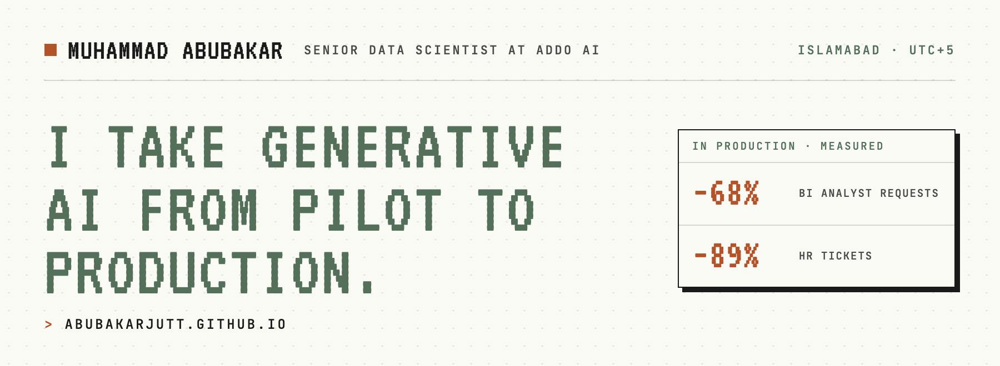

Most GenAI pilots look great in the demo and break on real data. I work on the part that comes after: getting them into production and keeping them working.

At Engro Holdings, my plain-English data and HR assistant for 3,000+ employees cut BI requests by **68%** and HR tickets by **89%**, and the client's own engineers now maintain it.

**[Portfolio](https://abubakarjutt.github.io/)** &nbsp;·&nbsp; **[Book a call](https://calendly.com/abubakarjutt/new-meeting)** &nbsp;·&nbsp; **[LinkedIn](https://www.linkedin.com/in/muhammad-abubakar-ds/)**

### Now

- Senior Data Scientist at **Addo AI**, building conversational AI on LangGraph, AWS Bedrock and FastAPI
- Forward deployed at **RAKEZ, UAE**: churn, renewal and lead-scoring models in production
- Building **[graphbrain](https://github.com/Abubakarjutt/graphbrain)**, a knowledge-graph tool, and **[Trivio](https://github.com/Abubakarjutt/Trivio)** in the open

### Experience

**Addo AI** &nbsp;2022 – present  
Associate Data Scientist → Data Scientist → Senior Data Scientist  
Forward deployed to Engro Holdings (2024–2025) and RAKEZ, UAE (2025–present). Built annotation tooling that cut labelling time by 82–96%, and mentored junior scientists.

**ITU** &nbsp;2021 – 2022  
Research Associate  
Crime-pattern analysis and bias mitigation; published findings.

**Auxtend** &nbsp;2019 – 2020  
Machine Learning Intern  
Fine-tuned a transformer chatbot and rebuilt semantic search: +20% accuracy, +30% relevance.

### Education

**M.S. Data Science**, University of Management and Technology &nbsp;2018 – 2020  
**B.S. Accounting and Finance**, University of Central Punjab &nbsp;2013 – 2016
